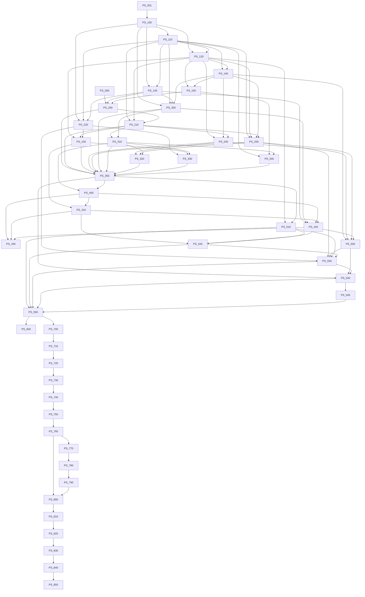

# Dependency graph

Programmatic prerequisites are acyclic. Human approvals are labels and milestone gates, not graph edges.

| Task | Phase | Programmatic prerequisites | Unratified / open dependencies | Ready now |
|---|---|---|---|---|
| PS-000 | P00 | - | DEC-22 | No |
| PS-001 | P00 | - | ADR-008, ADR-009 | No |
| PS-100 | P01 | PS-001 | ADR-008, OPEN-022 | No |
| PS-110 | P01 | PS-100 | - | No |
| PS-120 | P01 | PS-100, PS-110 | ADR-014, OPEN-016 | No |
| PS-130 | P01 | PS-100, PS-110 | ADR-011, ADR-014, OPEN-013, OPEN-020 | No |
| PS-140 | P01 | PS-110, PS-120 | ADR-010 | No |
| PS-150 | P01 | PS-120, PS-140 | ADR-007, ADR-008 | No |
| PS-200 | P02 | PS-000, PS-130, PS-150 | DEC-30, DEC-31, DEC-33, DEC-34, DEC-35, DEC-37, DEC-38, DEC-40 | No |
| PS-210 | P02 | PS-110, PS-120, PS-200 | DEC-34, DEC-40 | No |
| PS-220 | P02 | PS-100, PS-110, PS-130 | - | No |
| PS-230 | P02 | PS-120, PS-210, PS-220 | - | No |
| PS-240 | P02 | PS-120, PS-140, PS-210 | - | No |
| PS-250 | P02 | PS-110, PS-120, PS-140, PS-210 | ADR-013, ADR-017 | No |
| PS-300 | P03 | PS-100, PS-110, PS-130, PS-140 | ADR-002, ADR-010, OPEN-013 | No |
| PS-310 | P03 | PS-210, PS-300 | DEC-31, DEC-32, DEC-33, OPEN-004, OPEN-010, OPEN-018 | No |
| PS-320 | P03 | PS-240, PS-250, PS-310 | ADR-017 | No |
| PS-330 | P03 | PS-220, PS-230, PS-310 | ADR-018, OPEN-022, OPEN-029 | No |
| PS-340 | P03 | PS-110, PS-150, PS-310 | - | No |
| PS-350 | P03 | PS-200, PS-210, PS-230, PS-240, PS-250, PS-300, PS-310, PS-320, PS-330, PS-340 | ADR-001, ADR-002, ADR-003, ADR-004 | No |
| PS-400 | P04 | PS-310, PS-350 | - | No |
| PS-410 | P04 | PS-230, PS-400 | - | No |
| PS-420 | P04 | PS-130, PS-300, PS-400, PS-410 | - | No |
| PS-430 | P04 | PS-400, PS-410, PS-420 | OPEN-004 | No |
| PS-500 | P05 | PS-140, PS-240, PS-250, PS-420 | ADR-001, ADR-010 | No |
| PS-510 | P05 | PS-120, PS-350 | ADR-003 | No |
| PS-520 | P05 | PS-410, PS-420, PS-510 | - | No |
| PS-530 | P05 | PS-220, PS-250, PS-500, PS-510, PS-520 | ADR-009, ADR-011, ADR-012, ADR-013, ADR-017 | No |
| PS-540 | P05 | PS-350, PS-500, PS-530 | - | No |
| PS-545 | P05 | PS-540 | - | No |
| PS-550 | P05 | PS-510, PS-520, PS-530, PS-540, PS-545 | - | No |
| PS-600 | P06 | PS-550 | - | No |
| PS-700 | P07 | PS-550 | - | No |
| PS-710 | P07 | PS-700 | - | No |
| PS-720 | P07 | PS-710 | - | No |
| PS-730 | P08 | PS-720 | OPEN-004 | No |
| PS-740 | P08 | PS-730 | OPEN-010 | No |
| PS-750 | P08 | PS-740 | - | Yes |
| PS-760 | P08 | PS-750 | OPEN-013 | No |
| PS-770 | P09 | PS-760 | - | No |
| PS-780 | P09 | PS-770 | - | No |
| PS-790 | P09 | PS-780 | - | No |
| PS-800 | P10 | PS-760, PS-790 | - | No |
| PS-810 | P10 | PS-800 | - | No |
| PS-820 | P10 | PS-810 | - | No |
| PS-830 | P11 | PS-820 | - | No |
| PS-840 | P11 | PS-830 | - | No |
| PS-850 | P11 | PS-840 | OPEN-016 | No |
